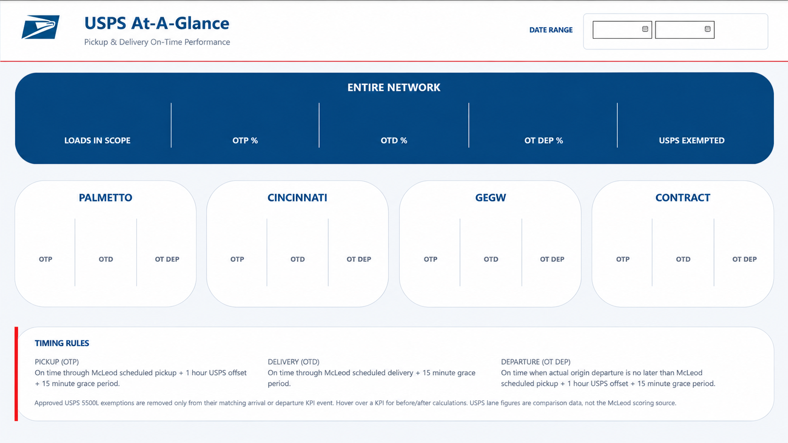
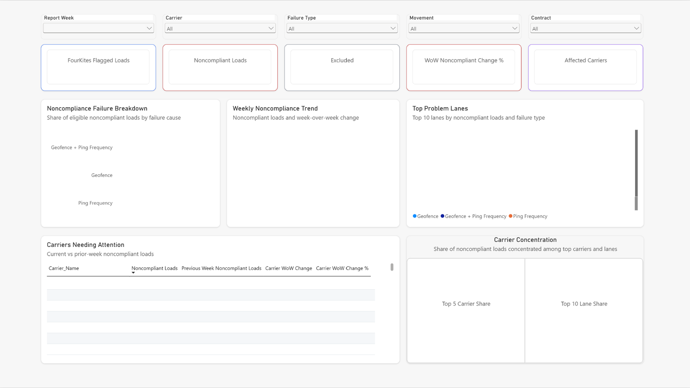
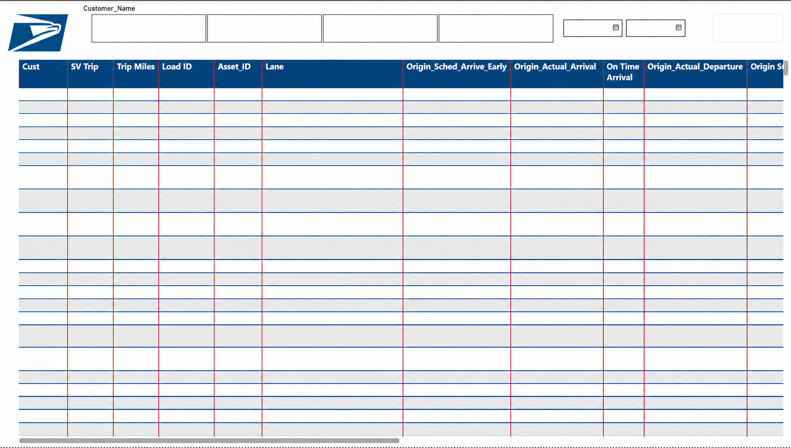
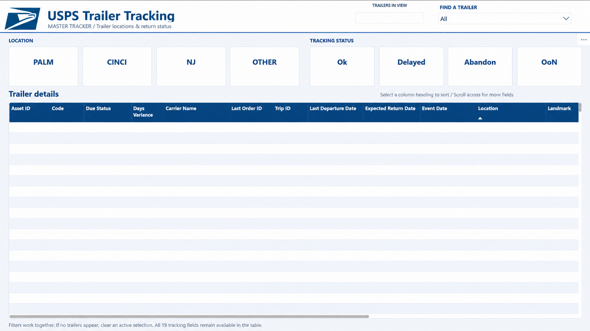

# Operations Analytics & Automation

**Six case studies. Four analytics models. Two automation workflows.**

A collection of projects focused on the everyday complexity of logistics operations: making service metrics trustworthy, finding tracking failures, explaining carrier economics, keeping tabs on equipment, and automating repetitive reporting tasks.

Each analytics example includes **synthetic data and independently written SQL**, with Power BI / DAX / Power Query examples where relevant. The automation examples show the flow visually and include offline Python demonstrations.

## Explore the projects

| Project | Challenge | Explore |
|---|---|---|
| **USPS Service Reconciliation** | Match arrival/departure events, apply adjudications correctly, explain on-time performance | [View case study](usps-service-reconciliation/) |
| **Carrier Non-Compliance** | Separate geofence and ping-frequency failures, track trends by carrier and lane | [View case study](carrier-noncompliance/) |
| **302 Carrier Economics** | Join order, trip, extra-pay and confirmation data without inflating financial metrics | [View case study](carrier-economics-302/) |
| **Trailer Tracking** | Normalize tracking events, select the latest status and match the right order | [View case study](trailer-tracking-addendum/) |
| **FourKites Daily Archive** | Capture eligible daily reports and organize them by date, replacing duplicates safely | [See visual flow](fourkites-daily-archive/) |
| **FourKites Weekly Archive** | Calculate a reporting week, name its files consistently and maintain the archive | [See visual flow](fourkites-weekly-archive/) |

## Power BI report gallery

These are **data-cleared presentation previews**, not screenshots of a running synthetic Power BI model.

| USPS At-a-Glance | Carrier Non-Compliance |
|---|---|
| [](usps-service-reconciliation/assets/screenshots/README.md) | [](carrier-noncompliance/assets/screenshots/README.md) |
| [6 page previews](usps-service-reconciliation/assets/screenshots/README.md) | [4 page previews](carrier-noncompliance/assets/screenshots/README.md) |

| Carrier Economics (302) | Trailer Tracking |
|---|---|
| [](carrier-economics-302/assets/screenshots/README.md) | [](trailer-tracking-addendum/assets/screenshots/README.md) |
| [1 page preview](carrier-economics-302/assets/screenshots/README.md) | [1 page preview](trailer-tracking-addendum/assets/screenshots/README.md) |

## Run the examples

**Python 3.9+**; SQL demonstrations use the built-in SQLite engine, without extra services.

```bash
cd workplace-analytics
python python/generate_synthetic.py
python -m unittest discover -s tests -v
python python/run_query_examples.py usps-service-reconciliation
```

You can swap the last project name for `carrier-noncompliance`, `carrier-economics-302`, or `trailer-tracking-addendum`. The two archiving workflows share an [offline Python example](python/archive_simulator.py) with automated tests.

The DAX and Power Query files are **illustrative starting points**, not fully rebuilt or Power BI Desktop-validated reports. All example records are fictional. Data-cleared report designs and any employer-associated presentation elements require appropriate publication permission.
