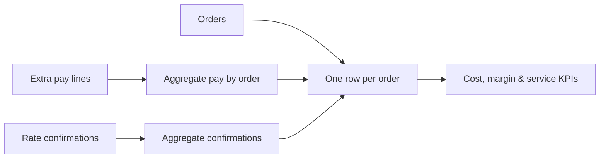

# 302 / Carrier Economics & Trip Performance

**Challenge:** Bring revenue, carrier cost, extra pay, trip performance and rate confirmations together without duplicating amounts when a single order has several related records.

## The key modeling decision

The synthetic SQL pre-aggregates one-to-many sources before they join the order fact. It then demonstrates order-level margin, extra pay, carrier profitability, trip service and confirmation timing.

## Dashboard preview

[Open the report page](assets/screenshots/README.md)

## Explore the implementation

[Order economics SQL](sql/10_economics.sql) · [Carrier and trip performance SQL](sql/20_performance.sql) · [DAX examples](dax/) · [Power Query example](power-query/)

From `workplace-analytics/`: `python python/run_query_examples.py carrier-economics-302`. All money, orders, dates and thresholds in the example are fictional; the preview is a data-cleared layout rather than a live report.
