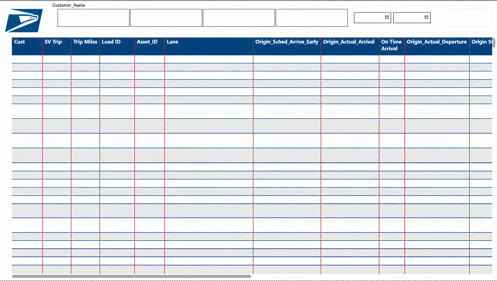

# 302 / Carrier Economics & Trip Service // public reconstruction

A synthetic SQL and BI case study based on concepts found in the supplied `302(1).zip` Power BI project. **No production query, data, or customer/carrier identifier is included.**

## Goal
Analyze order-level revenue, carrier cost, extra pay, margin, service timing, and confirmation processes without accidentally multiplying finance measures when joining one-to-many source tables.

## Included
- Relational schema with orders, trips, driver extra pay, and rate confirmations
- SQL order-grain aggregation, carrier scorecard, and lane profitability
- Demonstration DAX measures and Power Query synthetic CSV loader
- Generated synthetic inputs, automated unit tests, and technical architecture notes

## Dashboard page screenshots (no data)

The [302 data-cleared screenshot gallery](assets/screenshots/README.md) shows the underlying report design without disclosing shipment records, customers, lane assignments, timestamps or counts.

This is a redrawn presentation mockup, not a live output of the synthetic SQL/DAX examples. Employer branding and publication rights should be reviewed before public release.

## Reproduce
`python tools/generate_synthetic.py` and `python -m unittest discover -s tests -v` from the top-level package, or `python tools/run_query_examples.py carrier-economics-302`.

## Engineering concern
The model includes explicit one-to-many pre-aggregation and protects against zero-denominator margins. Sample pay and revenue figures are fictional. DAX/M examples require manual Power BI testing.
