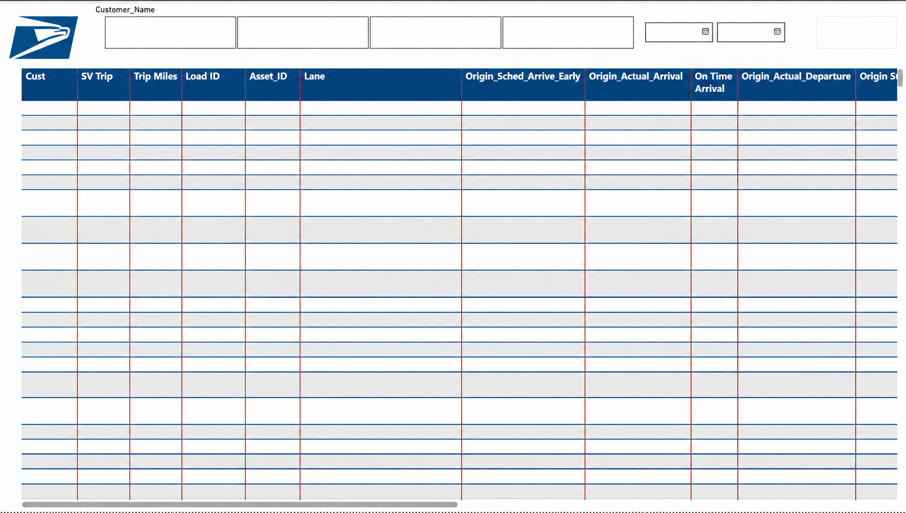

# 302 report // data-cleared screenshot gallery

> **Portfolio presentation only.** The image below is a redrawn, empty-state version of a supplied Power BI report screenshot. It is not a live report export and does not contain actual load, customer, asset, lane, timestamp, mileage, or other operational values.

| Page | Screenshot | Design elements retained |
|---|---|---|
| 302 trip service detail | [View image](01-302-trip-service-detail.png) | Customer selector layout, date controls, report KPI placeholder, scrollable trip-level matrix, headers, alternating blank rows |

**Publication review:** Although all visible report data was removed, the screenshot retains a USPS-style mark and report design. Confirm that workplace branding and layout may be publicly displayed before merging or publishing this asset.
