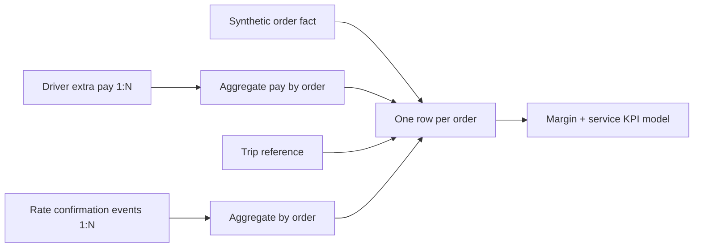

# Order-level economics and trip performance

**Source basis:** the supplied `302(1).zip` defines `Query`, `driver_extra_pay`, `SV Trips`, and measures. It includes a rich order-level export, trip schedule lookup, added pay details, and pages for 302 reporting, RC dates/duration, grid analysis, top carriers, and on-time trips. The archive has 16 explicit measures and 11 report pages, including hidden pages.

**Critical SQL design:** joining driver payment lines straight to the order fact multiplies revenue for orders with multiple pay records. Pre-aggregate each one-to-many dimension before joining. Rate confirmation timing is defined here as `latest acknowledged - first issued`, an illustrative operational definition that should not be confused with employer logic.

**Synthetic choices:** the 15-minute arrival tolerance, revenue/cost figures, trip IDs, carrier names, and fee code values are invented. Measures are descriptive, not audited accounting figures. A production model would explicitly define refund treatment, trip vs order attribution, and deduplication of amended confirmations.

**Page reconstruction:** economics overview, top carriers, trip on-time analysis, rate confirmation date/duration, and table/grids with fictional values.
