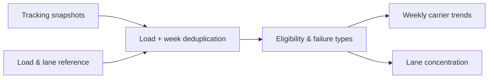
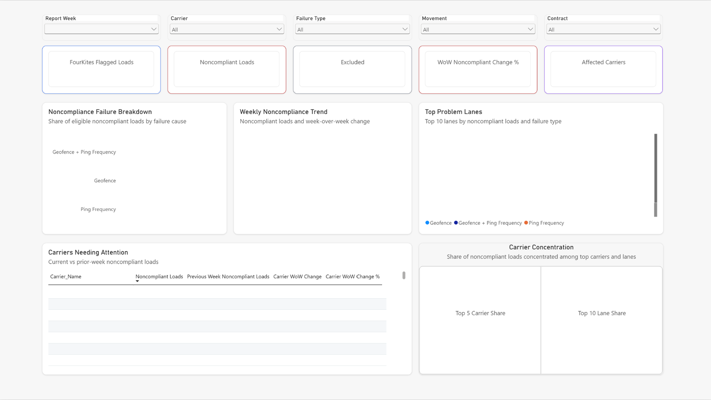

# Carrier Non-Compliance Intelligence

**Challenge:** Find which loads, carriers and lanes have tracking problems—and distinguish missing geofence events from infrequent pings.

The sample model builds a **one-load-per-week** reporting grain, applies an illustrative no-movement exclusion, and shows overlapping failure categories without double counting total noncompliant loads.

## From records to useful answers

**Questions it answers:** Which failure reason is most common? Which carriers are trending worse? Which lanes deserve review? Are excluded loads changing the denominator?

## Dashboard previews

[Browse all 4 report pages](assets/screenshots/README.md)

## Explore the implementation

[Classification SQL](sql/10_classification.sql) · [Weekly metrics SQL](sql/20_metrics.sql) · [DAX examples](dax/) · [Power Query example](power-query/)

From `workplace-analytics/`: `python python/run_query_examples.py carrier-noncompliance`. Test data and thresholds are illustrative; report screenshots are data-cleared presentation previews.
