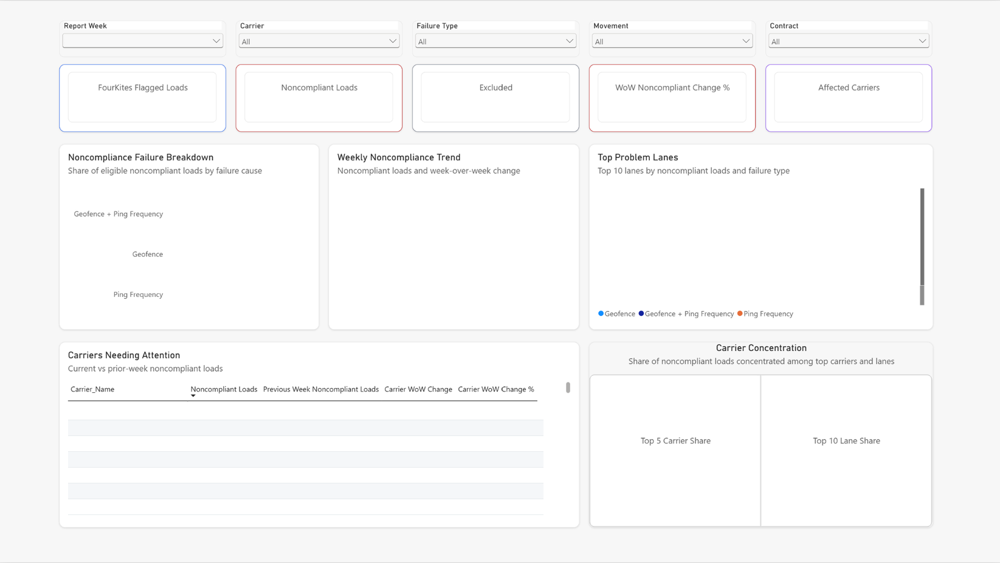
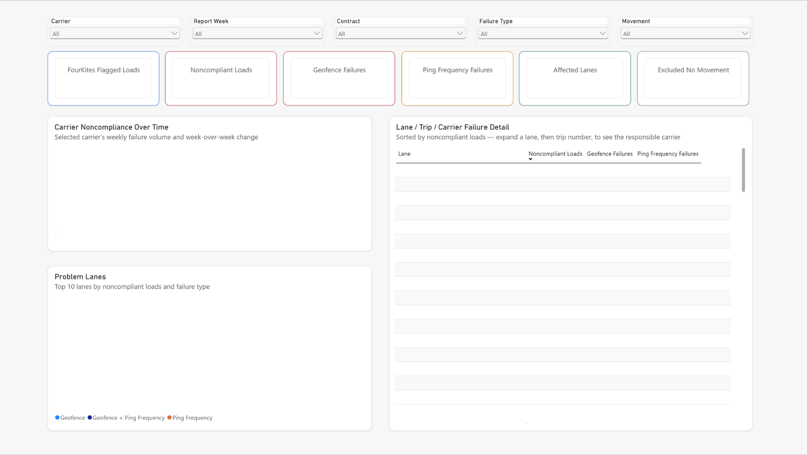
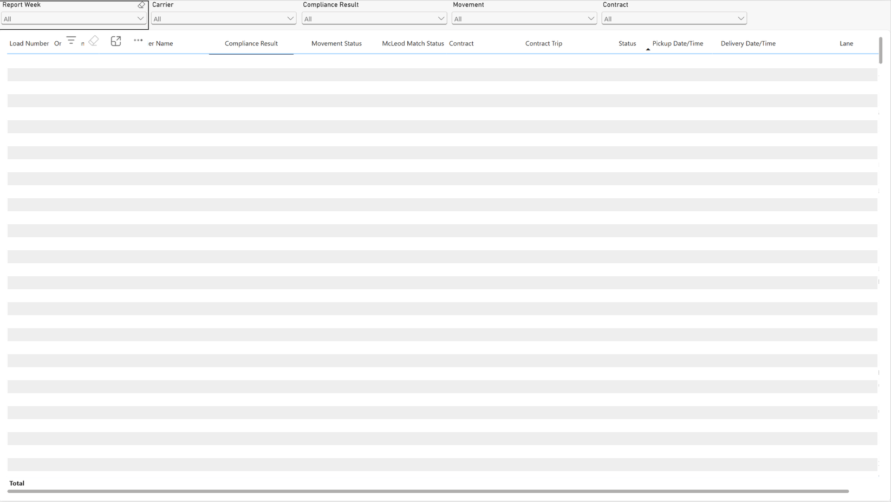
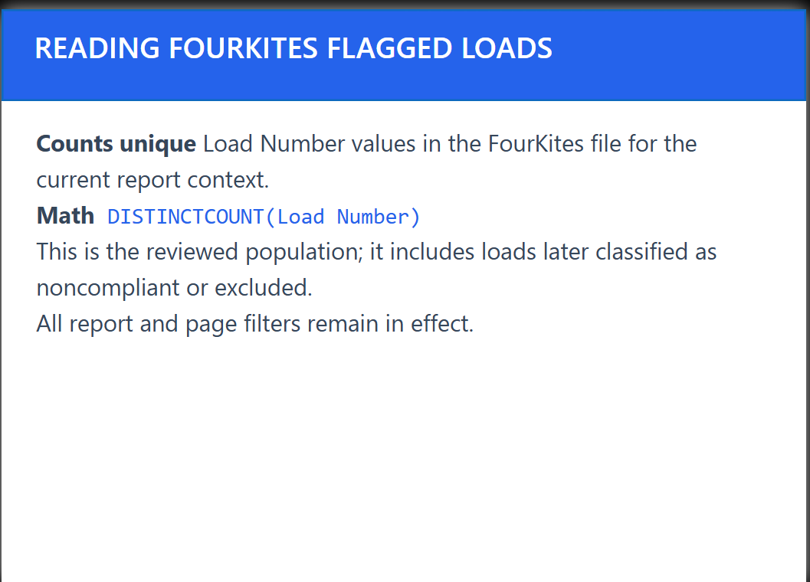

# Report page gallery // non-compliance, data-cleared

> These images are **redacted screenshots of the original dashboard pages**, not outputs from the synthetic SQL demonstration. KPI values, dates, chart series, lane details, carrier names, operational identifiers, and detail-table records were cleared. The tooltip contains only explanatory text and was retained.

| Page | Screenshot | What it demonstrates |
|---|---|---|
| Non-Compliance Overview | [Open](01-noncompliance-overview.png) | Top-level KPIs, failure causes, weekly trend, lane concentration, and carrier summary |
| Carrier Overview | [Open](02-carrier-overview.png) | Carrier-specific metrics, weekly performance, problem lanes, and lane/trip/carrier drilldown |
| Non-Compliance Detail | [Open](03-noncompliance-load-detail.png) | Record-level audit fields, statuses, movement and contract dimensions |
| Flagged Loads Tooltip | [Open](04-flagged-loads-tooltip.png) | Metric definition and DISTINCTCOUNT explanation without any source records |

## Gallery

**Publication review:** Removing visible numbers is not the same as obtaining employer consent for branded layouts, business logic descriptions, and screenshots. Check employer permissions before publishing.
