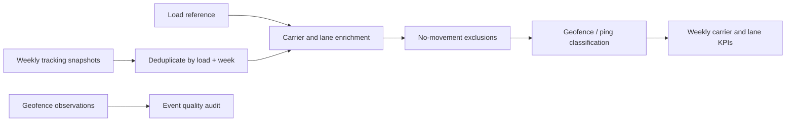

# Operational non-compliance / public architecture

**Source review:** supplied `Compliance.zip` includes `NonCompliance`, `fact_DailyGeofence`, 21 measures, 18 relationships, 12 pages (including definition/tooltips), and transformations joining load data with operational tables. Its named failure types include geofence and ping frequency; a no-movement exclusion appears explicitly.

**Synthetic implementation choices:** the 30-minute ping threshold is invented for demonstration. Original business thresholds, vendor records, and source paths are not reproduced. The weekly table grain is load-per-week after deterministic deduplication. For actual reporting, verify how snapshot precedence is defined. Counts across failure categories overlap only in explicit `both`; summing geofence and ping failure counts is not a valid estimate of total noncompliant loads.

**Pages to rebuild with synthetic charts:** overview, carrier overview, detailed load classification, failed-lane ranking, week-over-week trend, and six brief metric-definition tooltips.
