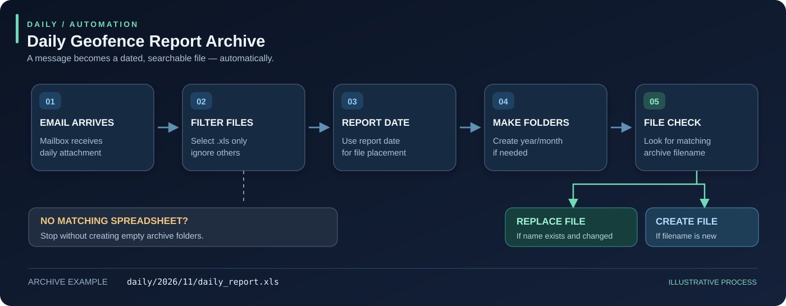

# FourKites / Daily Report Archiving

**One less repetitive inbox task.** This flow pattern watches for incoming reports, finds eligible daily spreadsheets and stores them in a predictable year/month archive.



## What happens to a report?

1. **An email arrives** in the reporting mailbox.
2. **Attachments are checked.** Only `.xls` spreadsheets go forward; everything else is ignored.
3. **The report date is used** to build its destination and filename.
4. **Year and month folders are checked**, and missing folders are created.
5. **Each eligible attachment is saved.** An existing filename gets replaced when its contents change; a new filename gets created. Identical content is left unchanged in the Python demo.

**Example folder layout**

```text
daily/
└── 2026/
    └── 11/
        ├── monday_report.xls
        └── tuesday_report.xls
```

### Why it matters

Consistent archive paths make reports easier to find and remove manual copying, missing folder steps, and repeated uploads. The branch for no matching attachments stops without creating empty archive folders.

The [offline Python implementation](../python/archive_simulator.py) demonstrates filtering, safe paths, create/replace and idempotent behavior with fictional attachments. The illustration documents a workflow pattern; it is not a live Power Automate export or connected SharePoint environment.
