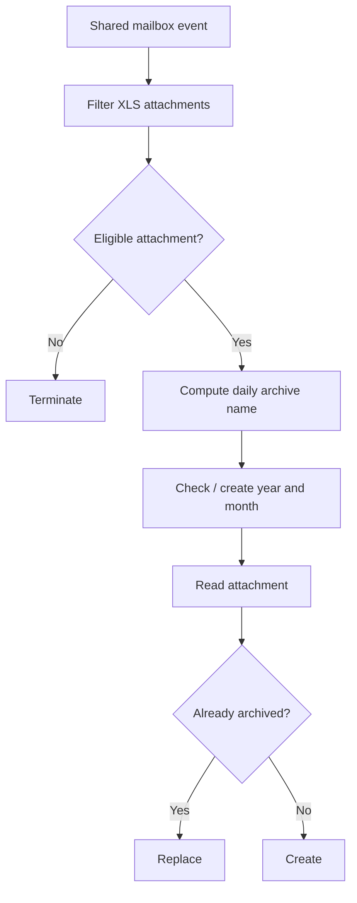

# Daily archive / workflow architecture

The supplied Power Automate flow export has one new-email shared mailbox trigger and 22 named actions (including nested actions). Its observable action sequence filters **XLS** attachments, terminates on no matches, composes date/file information, checks or creates year/month folders, iterates attachments, and replaces or creates destination files.

## Public implementation
`tools/archive_simulator.py` accepts an explicit report date and synthetic `Attachment` objects. This avoids leaking internal subject-parsing expressions and service account details. It creates date-partitioned directories, validates the extension, prevents path traversal, and uses atomic replacement. Equal files are idempotently skipped.

## Validation cases
No attachment; wrong extension; existing identical document; updated document; path traversal; missing folders; month boundary. **Flow runtime success was not proven by the export.**
