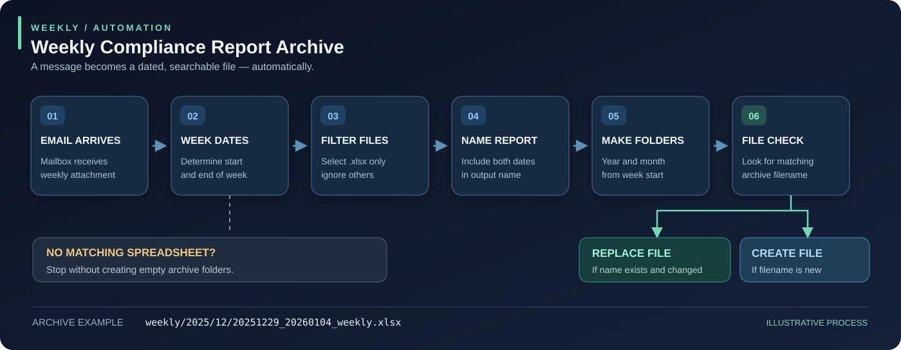

# FourKites / Weekly Report Archiving

**Organized reports for every reporting week.** This workflow pattern takes weekly spreadsheet attachments, identifies their reporting window and places them in a consistent archive.



## What happens to a report?

1. **A report email arrives** with attachments.
2. **The reporting window is determined**, with a start and end date for the week.
3. **Only `.xlsx` attachments** are processed.
4. **A date-range filename** keeps each week's reports distinct.
5. **Year and month folders** are checked or created using the reporting week's start date.
6. **An existing file is replaced when changed**, or a new file is created. The Python demo skips files whose contents are identical.

**Example: a week spanning New Year's Day**

```text
weekly/
└── 2025/
    └── 12/
        └── 20251229_20260104_weekly.xlsx
```

The archive folder follows **week start** (December 29), while the filename displays both boundaries, preventing confusing year-crossing weeks.

### Why it matters

Predictable names and paths simplify historical lookups and reduce duplicate manual processing. The example also checks that the start and end dates cover exactly seven inclusive calendar days.

The [offline Python implementation](../python/archive_simulator.py) demonstrates week validation, attachment filtering and create/replace behavior using fictional inputs. The illustration is a readable representation of the process, not an imported Power Automate definition.
