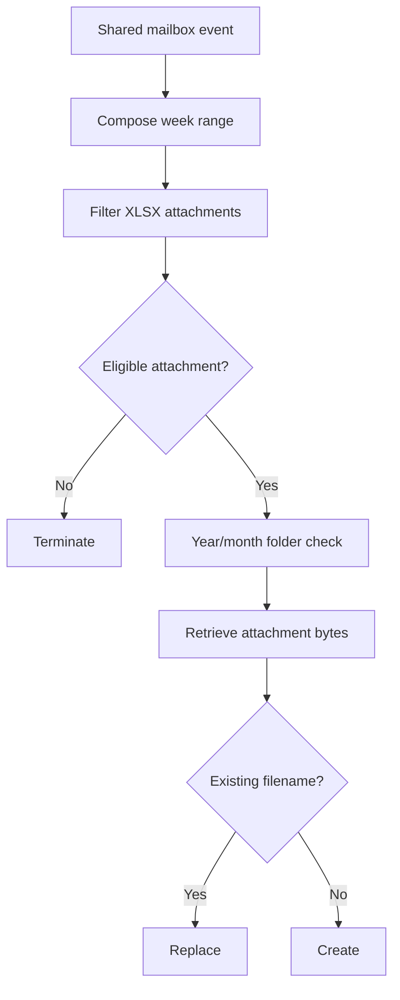

# Weekly archive / workflow architecture

The supplied Power Automate flow export has a shared-mailbox event trigger and 27 named actions (including nested actions). It composes report date range and week start/end, filters **XLSX** attachments, constructs an archive filename, handles year/month folders, and creates or replaces files.

## Public implementation
The synthetic demonstration uses explicit week boundaries, verifies a seven-day inclusive window, prefixes the filename with the range and persists idempotently. The original flow's exact date parsing, URLs, and connection bindings remain private.

## Test cases
Wrong extensions; malformed ranges; year/month crossing; repeated attachments; replacement; no valid files. No claim is made that the original flow was deployed or ran error-free.
