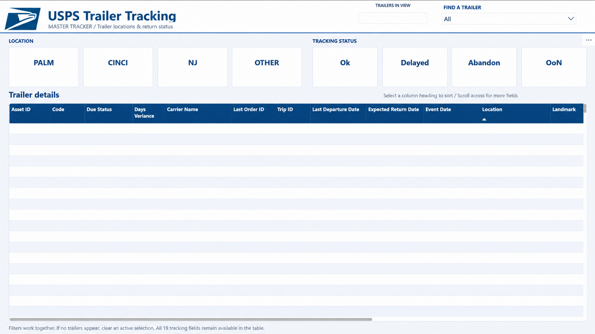

# Trailer Tracking / Supplementary public-safe model

This folder complements the existing public [trailer-tracking-powerbi repository](https://github.com/ImEyePatch/trailer-tracking-powerbi). It adds executable synthetic SQLite examples for deterministic latest-event selection, as-of order matching, approved-hub logic, and operational statuses; sample DAX/M and architecture documentation.

Based on *structure* observed in the supplied Tracking PBIP archive, not original production source. All source names and rows are illustrative.

Reproduce from package root with `python tools/generate_synthetic.py`, `python -m unittest discover -s tests -v`, or `python tools/run_query_examples.py trailer-tracking-addendum`.

## Dashboard page screenshot (no data)

The [blank-data screenshot gallery](assets/screenshots/README.md) documents the public-safe visual layout of the trailer tracking page.

**Important:** This is an edited presentation mockup with the trailer counts and table records removed. It is not a live output of the synthetic demo. Branding and report terminology should be reviewed before public release.
