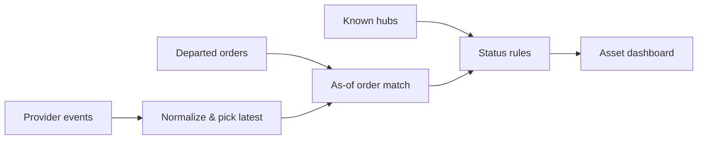

# Trailer Tracking / Asset Status

A small synthetic data model exploring how to combine tracking updates, active orders and hub locations into a usable asset-status view. This complements the [dedicated Trailer Tracking Power BI project](https://github.com/ImEyePatch/trailer-tracking-powerbi).

## How status is determined

This example makes latest-event selection deterministic, keeps future orders out of historical matches, and separates motion, hub and planned-return conditions. Status thresholds are illustrative.

## Dashboard preview

[Open the report page](assets/screenshots/README.md)

## Explore the implementation

[Latest-state SQL](sql/10_latest_state.sql) · [DAX examples](dax/) · [Power Query example](power-query/)

From `workplace-analytics/`: `python python/run_query_examples.py trailer-tracking-addendum`. Asset IDs and events are entirely fictional; the image is a layout preview.
