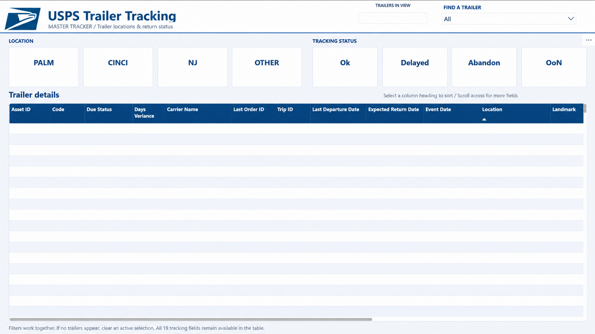

# Trailer tracking gallery // no-data layout

> **Presentation-only, data-removed recreation** of a trailer-tracking Power BI page based on a supplied screenshot. No actual trailer IDs, carrier names, event timestamps, locations, due statuses, or return counts are intended to appear. The image is a redrawn mockup, not a pixel-perfect Power BI export.

**Review note:** The screenshot preserves structural layout, column headers, and general terminology to document the report design. Confirm that sharing employer-associated branding, layout language, or report concepts is permitted before public release.

| Page | Screenshot | Design highlights |
|---|---|---|
| Trailer Tracking Overview | [Open](01-trailer-tracking-overview.png) | Header KPIs, location/status summary cards, sortable trailer-details table with all row data removed |

## Preview

All images are mockups with data omitted rather than report exports. The underlying *structure* is illustrative and should be treated as presentation support for the public-safe technical reconstruction.
