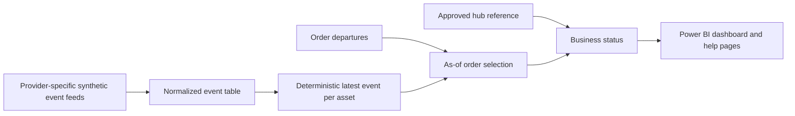

# Trailer tracking source archive / public addendum

The supplied Tracking PBIP contains `New Traffic`, `Assets PALM CINCI Active`, status measures and multiple tracking/help pages. It models a common asset contract (asset ID, last event, speed, idle duration, hub, as-of order, planned return and status). This addendum expands on the existing public [Trailer Tracking Power BI](https://github.com/ImEyePatch/trailer-tracking-powerbi) reconstruction rather than replacing it.

**Invariants:** exactly one latest asset row, strict timestamp precedence and deterministic event ID tie-breaking; no future order joined to older events; planned-return status only after as-of order enrichment; explicit out-of-network handling; measured idle duration separate from categorical motion state.

**Illustrative business thresholds:** idle >48 hours and delayed after expected return are chosen for demonstration. Do not assume they match current employer procedures. Pinned mock values in the public fixture do not represent real assets.

**Page mapping:** Master Tracker, origin hub, delayed-return fees and distinct status/help pages should be photographed using *synthetic* values or screenshot redaction guidance.
