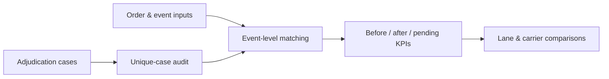
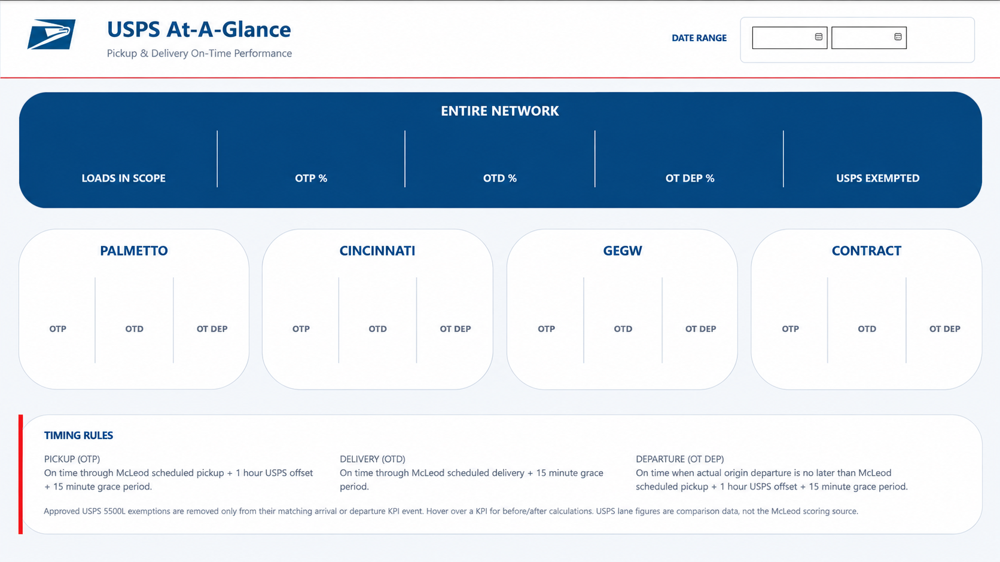

# USPS Service Reconciliation

**Challenge:** Two reporting systems can disagree about the same arrival or departure. Timestamp matching, event eligibility and adjudications all affect the on-time numbers.

This example reconstructs the analytical approach using fictional events and independently written SQL, DAX and Power Query examples.

## How it works

- Match approved adjudications to **one specific event**, not every event for the same load.
- Keep missing timestamps outside scored denominators.
- Show the original result, approved-exclusion result and hypothetical pending-approval result separately.
- Compare service performance by lane and carrier without hiding unmatched cases.

## Dashboard previews

[Browse all 6 report pages](assets/screenshots/README.md)

## Explore the implementation

- [Event reconciliation SQL](sql/10_event_reconciliation.sql)
- [Adjudication matching SQL](sql/20_adjudication_audit.sql)
- [KPI and lane views](sql/30_kpis.sql)
- [DAX examples](dax/) · [Power Query example](power-query/)

From `workplace-analytics/`: `python python/run_query_examples.py usps-service-reconciliation`. All sample events and results are invented; the DAX/M examples require Power BI validation. The dashboard preview has been cleared of operational values.
