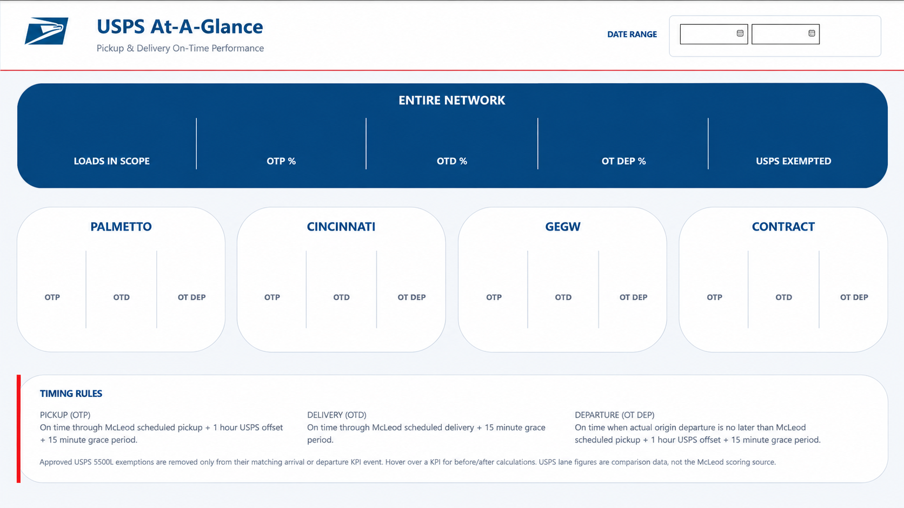
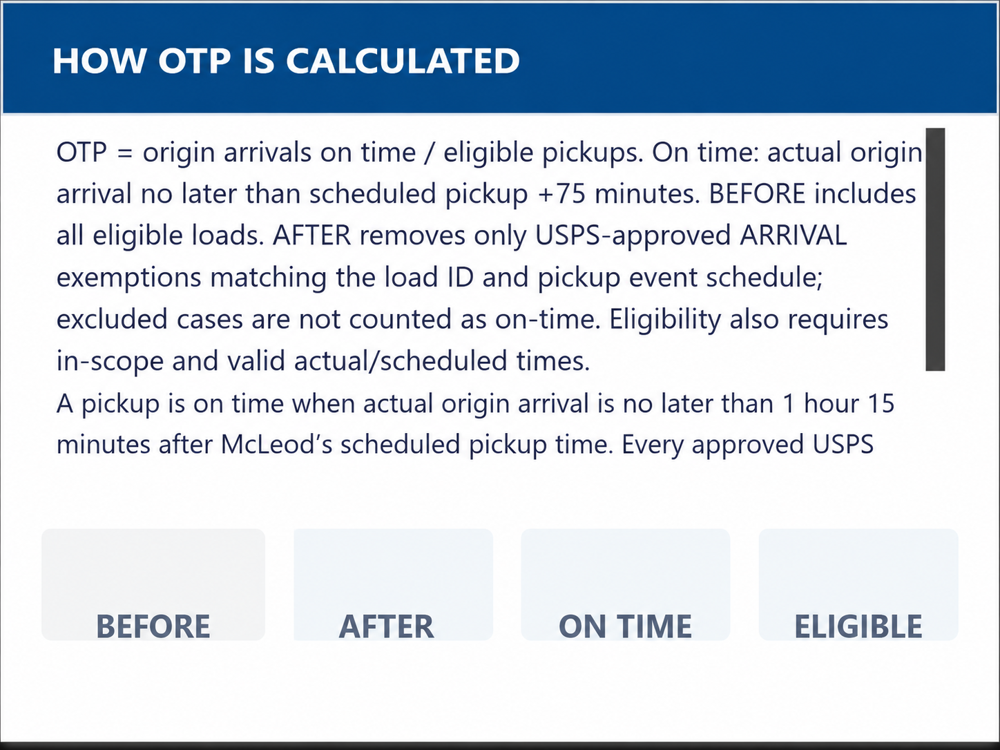
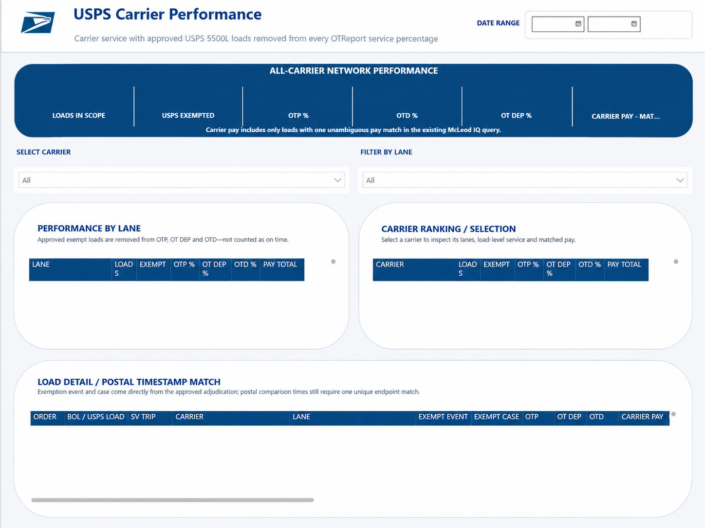
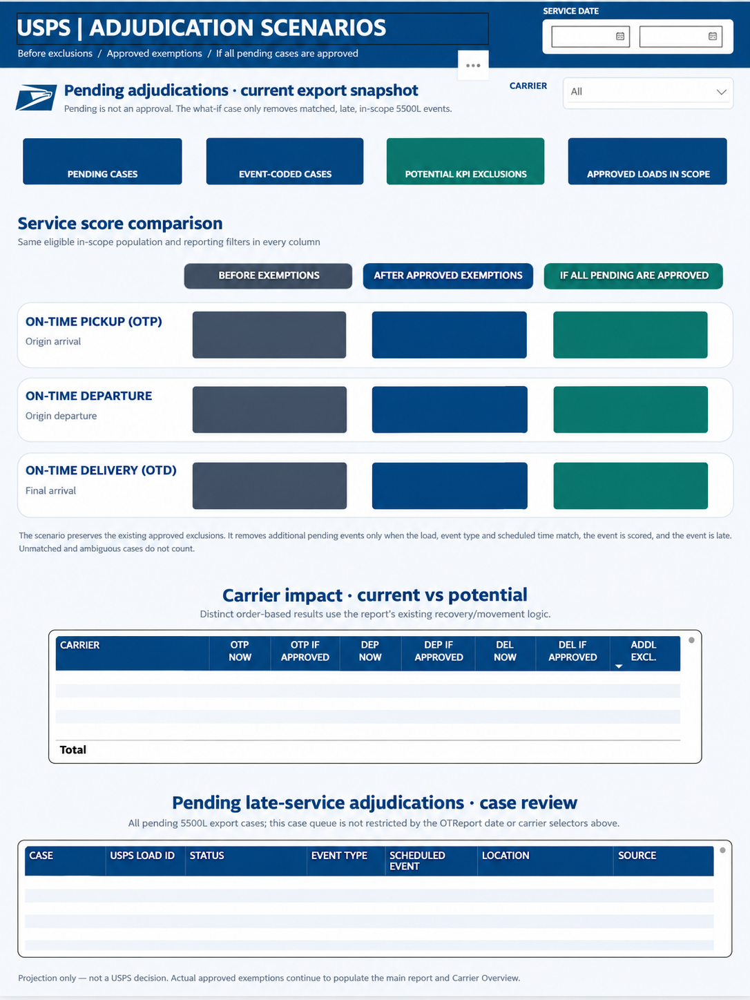
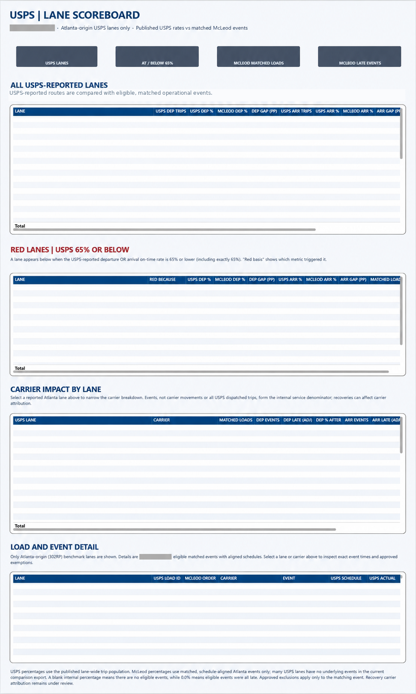
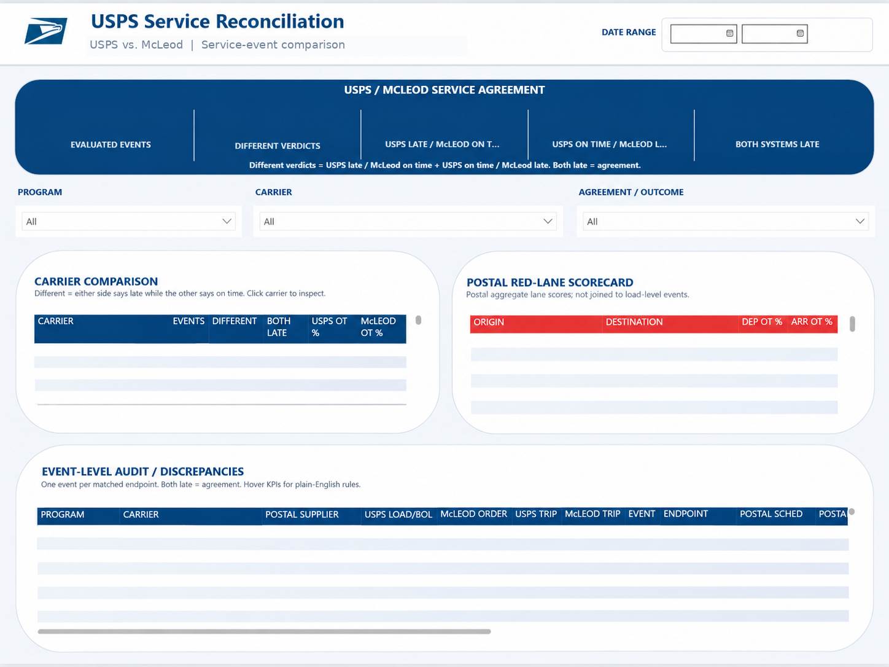

# Report page gallery // no-data layouts

> **Presentation-only, data-removed recreations** of Power BI pages based on supplied screenshots. No actual records, KPI results, date ranges, carrier names or financial figures are intended to appear. Images were redrawn using an image model and are **not pixel-perfect original Power BI exports**. The report code in this repository is a separately authored, synthetic technical reconstruction.

**Review note:** Metric headings, rule descriptions, general program terminology and table column headers are shown to explain the report design. Before public release, confirm that sharing the employer-associated layout, terminology, or branding is permitted.

| Page | Screenshot | Design highlights |
|---|---|---|
| At-a-Glance Overview | [Open](01-at-a-glance-overview.png) | Network metrics and region cards; values cleared |
| OTP Tooltip | [Open](02-otp-tooltip.png) | Definition, timing rule, before/after cards |
| Carrier Performance | [Open](03-carrier-performance.png) | Network summary, lane/carrier ranking and load-detail tables |
| Adjudication Scenarios | [Open](04-adjudication-scenarios.png) | Before/current/what-if comparison; pending case review |
| Lane Scoreboard | [Open](05-lane-scoreboard.png) | Benchmark comparison, red-lane review, carrier impact and event detail |
| Service Reconciliation | [Open](06-service-reconciliation.png) | USPS-versus-TMS agreement, carrier comparison and event audit |

## Preview

### Full page thumbnails

<table>
<tr><td></td><td></td></tr>
<tr><td></td><td></td></tr>
<tr><td></td><td></td></tr>
</table>

All images are mockups with data omitted rather than report exports. The underlying *structure* is illustrative, not a guarantee that the synthetic SQL/DAX examples generate the same visuals.
