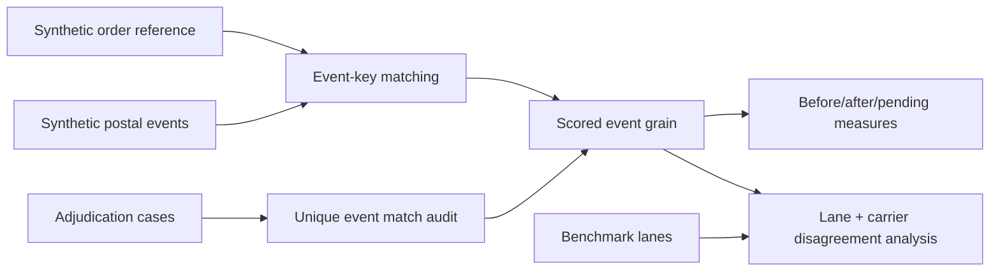

# USPS event-scoring architecture

**Source basis:** the uploaded USPS At-A-Glance PBIP has separate OTReport, USPS Events, Adjudications, Exemption Audit, Service Detail, Lane Benchmark, and Lane Map tables. Its report definition contains 29 pages (including hidden QA and tooltip pages) and 129 non-auto-date measures. This is an **independently rewritten illustration** of those categories, not a transcription.

**Grain:** each USPS event is uniquely identified by `event_id`. The public scenario only models one origin departure and one final arrival per load; intermediate stops are intentionally out of scope. Approval matches require `load_id + event_type + scheduled_at` and exactly one candidate event. Unscored/missing actuals never enter scoring denominators. Approved exclusions change the scored population; pending approvals are hypothetical, not silently applied.

**Quality gates:** unique event IDs; approval audit with explicit unmatched, insufficient, ambiguous statuses; no double-counting of multiple forms; a stable source population; per-event-type approval; no denominator-zero exceptions; compare only events where both source verdicts exist.

**Reporting pages to reconstruct:** At-A-Glance overview, service reconciliation, pending scenarios, lane scoreboard, all-carrier performance, timestamp QA, eligibility audit, and explanatory tooltips. Use only synthetic chart data.
